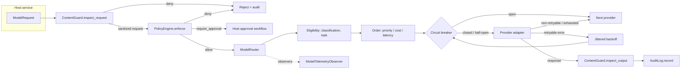
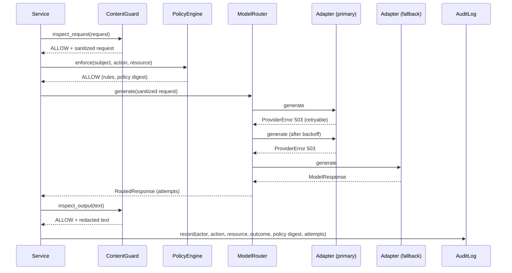

# agentic-core architecture

## Purpose

`agentic-core` is a library, not a service. It holds the controls that every
agent-facing service in the portfolio must apply identically: model access,
policy decisions, audit evidence, content security and telemetry. Services
deploy it in-process; it has no network listener and no persistent state of
its own except audit sinks the host service configures.

## Context (C4 level 1)

```mermaid
C4Context
  title agentic-core in the platform
  Person(operator, "Platform operator", "Configures providers, policies and keys")
  System_Boundary(platform, "Agent platform services") {
    System(identity, "agent-identity-fabric")
    System(gateway, "MCP / A2A gateway")
    System(runtime, "Domain agent runtimes")
  }
  System_Ext(models, "Foundation model APIs", "Anthropic, OpenAI/Azure, Google, Bedrock, self-hosted")
  System_Ext(otel, "OpenTelemetry collector")
  System_Ext(kms, "KMS / HSM", "Audit signing keys")
  System_Ext(worm, "WORM storage", "Audit retention")
  Rel(identity, models, "via agentic-core router")
  Rel(gateway, models, "via agentic-core router")
  Rel(runtime, models, "via agentic-core router")
  Rel(platform, otel, "OTLP")
  Rel(platform, kms, "sign audit hashes")
  Rel(platform, worm, "append audit events")
  Rel(operator, platform, "policy and provider config (GitOps)")
```

## Components (C4 level 3)



The library does not force this order on callers; it provides the
components. Each service repository documents its own pipeline and tests
that the order holds.

## Request sequence



## Key properties

| Property | Mechanism | Verified by |
|---|---|---|
| Restricted data only reaches approved providers | `ProviderProfile.max_classification` filter runs before any ordering or failover | `tests/chaos/test_router_faults.py` (property test over random fault scripts) |
| Provider outage does not stop service | Circuit breaker per provider, retry with full-jitter backoff, failover | `tests/unit/test_router.py` |
| Every decision is attributable to a policy version | `PolicyDecision.policy_digest` is the SHA-256 of the canonical policy set | `tests/unit/test_policy.py` |
| Audit tampering is detectable | SHA-256 chain plus Ed25519 signature over each event hash | `tests/unit/test_audit.py::TestTamperDetection` |
| Untrusted content cannot pose as instructions | Trust levels on messages, per-trust injection thresholds, random-boundary isolation | `tests/security/test_content_security.py` |
| Credentials never sit in config | Provider specs reference environment variable names; `extra="forbid"` rejects inline keys | `tests/unit/test_factory.py` |
| Controls do not add material latency | Regex detectors are linear-time on adversarial input | `tests/performance/test_hot_paths.py` |

## Deployment

As a library, `agentic-core` ships as a wheel with an SBOM and build
provenance attestation (`.github/workflows/release.yml`). Container images,
Helm charts, Kubernetes manifests and Terraform live in the service
repositories that embed it; see ADR-0001.
